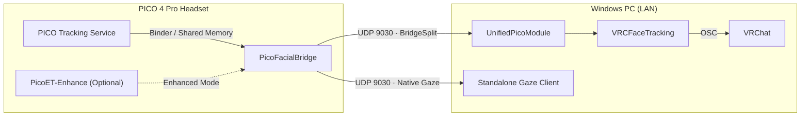

<div align="center">

# PicoFacialBridge

Rootless LAN eye and face tracking bridge for PICO 4 Pro. Runs alongside Virtual Desktop with no Root, Magisk, or PICO Connect required.

[](https://github.com/WolalaQAQ/PicoFacialBridge/actions/workflows/android.yml)
[](https://github.com/WolalaQAQ/PicoFacialBridge/releases)
[](LICENSE)

**English** | [简体中文](README_zh.md)

[Quick Start](#quick-start) · [Enhanced Mode](#optional-enhanced-mode) · [App Interface](#app-interface) · [Standalone Gaze](#standalone-native-gaze) · [Troubleshooting](#troubleshooting) · [Development](#development) · [Community](#community)

</div>

---

## Why PicoFacialBridge

PicoFacialBridge is a standalone Android app on the PICO 4 Pro that reads the headset's eye and face tracking data and streams it over your local network to a Windows PC.

- **Rootless and self-contained:** No Root, Magisk, Shizuku, or PICO Connect required. ADB is optional for installation or debugging and is not needed for daily use.
- **Runs alongside streaming apps:** Does not occupy an OpenXR session, so it works side by side with Virtual Desktop. A foreground service keeps forwarding after you close the app window.
- **Zero-lag split streaming:** Eye and face channels transmit independently at their native source rates without smoothing or interpolation, sending only what the PC actually subscribes to.
- **Dual-consumer support:** Serves VRCFaceTracking via [UnifiedPicoModule](https://github.com/WolalaQAQ/UnifiedPicoModule) and an independent native-gaze client at the same time.



> [!IMPORTANT]
> Avatar tracking uses the **BridgeSplit** protocol and requires [UnifiedPicoModule](https://github.com/WolalaQAQ/UnifiedPicoModule). Legacy `PicoFacialDataModule` builds and forks cannot receive this format; use [v0.2.0](https://github.com/WolalaQAQ/PicoFacialBridge/releases/tag/v0.2.0) if you still need the old protocol.

---

## Compatibility & Requirements

Verified on **PICO 4 Pro** running **PICO OS 5.13.7** (Android 10 / API 29, `arm64-v8a`), rootless.

| Component | Requirement |
|---|---|
| **Headset** | PICO 4 Pro with working eye and face tracking hardware |
| **Firmware** | PICO OS 5.13.7 (depends on PICO's internal tracking service and shared-memory layout) |
| **PC (Avatar tracking)** | Windows with VRCFaceTracking and [UnifiedPicoModule](https://github.com/WolalaQAQ/UnifiedPicoModule) |
| **PC (Standalone gaze)** | Any client implementing the [gaze subscription protocol](GAZE-PROTOCOL.md) |
| **Network** | Headset and PC on the same trusted local Wi-Fi network with **UDP 9030** reachable |
| **VRChat** | Face-tracking-ready avatar with OSC enabled |

---

## Quick Start

### 1. Install the APK on your headset

1. Download `PicoFacialBridge-v<version>-arm64-v8a-debug.apk` (for example `PicoFacialBridge-v0.7.0-arm64-v8a-debug.apk`) from [Releases](https://github.com/WolalaQAQ/PicoFacialBridge/releases). Do not download the GitHub source ZIP.
2. Sideload the APK with your usual headset file manager or installer. If you prefer ADB, enable Developer Mode and USB Debugging, connect the headset, and run:

   ```sh
   adb install -r PicoFacialBridge-v0.7.0-arm64-v8a-debug.apk
   ```

3. Open **PicoFacialBridge** from the headset's 2D app library. Ensure eye and face tracking are enabled in PICO system settings, tap **Start**, and grant both tracking permissions when prompted.

> [!NOTE]
> Release APKs use an automatically generated debug signature that can differ between builds. If Android rejects an in-place update due to a signature mismatch, verify the download source, uninstall the previous version, and install the new APK. Uninstalling resets saved app preferences.

### 2. Install UnifiedPicoModule on your PC

1. Install the PC receiver module in VRCFaceTracking by following the [UnifiedPicoModule README](https://github.com/WolalaQAQ/UnifiedPicoModule). Disable other PICO modules first to prevent UDP 9030 port conflicts.
2. By default, `UnifiedPicoModule` discovers the headset automatically via LAN multicast (`239.255.255.250`). If discovery fails or you have multiple headsets on the same network, set the headset's IPv4 address (shown on the **Diagnostics** tab) in `UnifiedPicoModule.json` and restart VRCFT:

   ```json
   "Bridge": { "IP": "192.168.1.123" }
   ```

   See the [UnifiedPicoModule configuration guide](https://github.com/WolalaQAQ/UnifiedPicoModule/blob/main/docs/configuration.md) for the config file path and all available options.

### 3. Daily workflow

1. Put on the headset, open **PicoFacialBridge**, and tap **Start**. You can close the window once the status shows **Running**.
2. Launch **VRCFaceTracking** on your PC. Once connected, PicoFacialBridge displays the client address with non-zero send rates, and VRCFT's Output page shows `Bridge/BridgeSplit: state=Connected`.
3. Launch Virtual Desktop and VRChat, and make sure OSC is enabled.
4. When finished, tap **Stop** inside the app or directly from the persistent Android notification.

---

## Optional Enhanced Mode

If your headset has the optional [PicoET-Enhance](https://github.com/WolalaQAQ/PicoET-Enhance) Magisk module installed, PicoFacialBridge automatically detects **Enhanced mode** and forwards real pupil diameter alongside independent per-eye expressions (including separate right inner-brow tracking via `X` packets).

PicoFacialBridge itself remains completely rootless. Post-processing settings and module installation live in [PicoET-Enhance](https://github.com/WolalaQAQ/PicoET-Enhance).

---

## App Interface

The app stays organized around a persistent service header (status, detected tracking mode, **Start / Stop / Restart**, and the **English / 中文** switcher) above three tabs. Changing language preserves your active tab and saved transmission switches.

### Eye & face

Controls avatar tracking sent to `UnifiedPicoModule`:

- **Transmit eye tracking / Transmit face tracking:** Independent channel switches saved automatically and applied immediately. Turning both off pauses capture and transmission while keeping discovery and control alive.
- **Send rates (Hz):** Counts new source frames successfully sent to the avatar client over the last second. Held frames and keepalives are excluded, so `0 Hz` means no client is connected, the channel is off, or no fresh frames are arriving.
- **Channel intersection rule:** Only channels enabled locally *and* subscribed to by the PC are sent. When only eye tracking is active, eye-region expressions (blink, brows, `EyeWide`, `EyeSquint`, etc.) are sent alongside native eye data and Face Hz displays `0`. When only face tracking is active, neither native eye data nor eye-region expressions are sent.
- **Permissions note:** PICO runs eye and face tracking in one shared algorithm, so both runtime permissions are required even if you only transmit one channel. The switches gate data transmission rather than camera power.

### Gaze

Monitors the separate direct native-gaze consumer:

- Displays subscription state (`Waiting for a subscriber`, `Subscribed`, `Client unsubscribed`, `Subscription expired`, or `Send failed`), client endpoint, subscription ID, epoch, remaining lease, send rate, and packet count.
- Reports the latest **Native sample** state (`Waiting`, `Fresh · valid combined gaze`, `Fresh sample · invalid gaze`, or `Sample expired`) and source age separately.
- **Eye transmission settings** jumps back to the shared eye switch on the Eye & face tab. Disabling that switch stops both avatar eyes and standalone gaze output.

### Diagnostics

Shows the headset's UDP endpoint (`<IPv4>:9030`), native eye/face frame counts, ring history overruns, latest error, and expandable/copyable service logs.

Tapping **Tracking values →** at the top of Diagnostics opens the read-only live **Tracking Inspector**:

- **Four region tabs:** `Eye expr.` (default), `Cheeks`, `Mouth`, and `Native`. The expression tabs display all 52 + 1 expressions (`BrowInnerUpR` in enhanced mode) in 32 paired/single rows; `Native` shows raw wire pupil values and millimeters (`raw ÷ 10`), 0–1 eye openness, signed −1…1 head-relative XYZ gaze vectors, status words, and source timestamps.
- **Live & honest readings:** Refreshes on each display frame while open and stops callbacks on exit, without requesting extra capture or modifying PC subscriptions. Numbers are never clamped to the 0–1 bar range (out-of-scale values turn amber), and invalid, expired, mode-filtered, uncaptured, or disabled values appear with explicit states instead of fabricated zeroes.
- **Toolbar & Inspector tools (`⋯`):** Search expressions by English or Chinese name, filter to active nonzero values (`|v| > 0.01`), toggle **Freeze / Live** to pause the display while forwarding continues, or open **Sent packet details** to inspect source snapshots alongside the last successful `E`, `A`, `F`, and `X` UDP sends (with flags, channel masks, epochs, and group clocks) separately for avatar and gaze routes.

---

## Standalone Native Gaze

Compatible PC gaze consumers can subscribe directly to the headset on **UDP 9030** from their own ephemeral PC UDP port without running VRCFaceTracking or a PC relay.

- **Independent lifecycle:** The avatar client and standalone gaze client connect, renew, and stop independently. Stopping one never unsubscribes the other.
- **Low-latency native `E` packets:** Gaze-only sessions forward only the newest fresh native `E` sample (within 150 ms) without waiting for facial expressions or sending `A`/`F`/`X` packets.
- **Shared local eye gate:** Keep **Transmit eye tracking** enabled in PicoFacialBridge; turning it off gates both outputs.

For wire commands, lease renewal, epoch handling, and byte offsets, see [GAZE-PROTOCOL.md](GAZE-PROTOCOL.md).

---

## Troubleshooting

| Symptom | What to check |
|---|---|
| **VRCFT cannot find the headset** | Confirm PC and headset are on the same LAN without router client isolation or guest Wi-Fi, and check for VPNs or virtual network adapters. Set `Bridge.IP` explicitly in `UnifiedPicoModule.json`. |
| **Firewall blocks connection** | Allow VRCFaceTracking to use **UDP 9030** on Private networks in Windows Firewall rather than disabling the firewall globally. |
| **Connected, but send rate stays at 0 Hz** | Ensure the eye/face transmission switches are enabled, put on and wake the headset, and verify both tracking permissions and PICO system tracking settings are turned on. |
| **Error or unsupported layout shown** | Open **Diagnostics → Service logs**, copy the error, and check your headset model and PICO OS version. |
| **Tracking stops after sleep or Wi-Fi change** | Wake the headset, check its current IPv4 address under **Diagnostics**, tap **Restart**, and reconnect VRCFT. |
| **Data arrives in VRCFT, but avatar does not move** | Check VRCFT's Output tab, confirm VRChat OSC is enabled, and verify your avatar supports VRCFT parameters. |
| **APK update fails to install** | Debug keys can differ between builds; uninstall the old app before installing the new APK. Make sure you downloaded the user APK, not the `androidTest` APK. |

When [opening an issue](https://github.com/WolalaQAQ/PicoFacialBridge/issues), include the app version, headset model, PICO OS version, VRCFT/module versions, reproduction steps, and sanitized diagnostic logs. Do not upload raw biometric samples, device identifiers, or signing keys.

---

## Privacy & Security

PicoFacialBridge forwards tracking data only to connected clients on your local network, keeps inspected samples strictly in memory (never written to disk or logs), and logs only connection state, rates, and validity. It uses standard Android runtime permissions, keeps system camera/sensor indicators intact, and does not modify system partitions or bundle proprietary PICO libraries.

> [!WARNING]
> Both BridgeSplit and the standalone gaze protocol send unencrypted, unauthenticated UDP datagrams. Use PicoFacialBridge only on trusted local networks and never forward UDP 9030 to the public internet.

---

## Development

### Project Structure & Protocol

| Directory | Contents |
|---|---|
| `bridge/` | Rootless Android app, UI dashboard, Tracking Inspector, and UDP foreground service |
| `shared/` | JNI native bridge, shared-memory parsers, frame pump, and BridgeSplit wire framing |
| `probe/` | Developer diagnostic app |
| `tests/` | Host unit/protocol/cadence/gaze suites, static UI contracts, and APK verification |

BridgeSplit communicates over **UDP 9030** with multicast discovery on **239.255.255.250**. Full packet formats and control flows are documented in the [UnifiedPicoModule protocol reference](https://github.com/WolalaQAQ/UnifiedPicoModule/blob/main/docs/protocol.md), and the standalone gaze namespace is specified in [GAZE-PROTOCOL.md](GAZE-PROTOCOL.md). Protocol changes must be coordinated with `UnifiedPicoModule`.

### Building from Source

Requires **JDK 17** and the Android SDK command-line tools (Gradle Wrapper `8.9`, Android Gradle Plugin `8.7.3`). Set `JAVA_HOME` and `ANDROID_HOME`, add `sdkmanager` to `PATH`, and install the pinned toolchain:

```sh
sdkmanager --licenses
sdkmanager "platforms;android-35" "build-tools;35.0.0" "ndk;26.1.10909125" "cmake;3.22.1"

git clone https://github.com/WolalaQAQ/PicoFacialBridge.git
cd PicoFacialBridge

# Linux / macOS
bash ./gradlew :bridge:assembleDebug

# Windows PowerShell
.\gradlew.bat :bridge:assembleDebug
```

Only `:bridge` is needed for the user app (`:probe` is for developer diagnostics). The installable debug-signed APK is written to `bridge/build/outputs/apk/debug/bridge-debug.apk`.

### Host Checks

```sh
bash tests/run-host-tests.sh
python3 tests/test_ui_dashboard.py
python3 tests/test_inspector_frames.py
python3 tests/test_rootless_boundary.py
pwsh -File tests/check-translations.ps1

# Requires a built debug APK (uses Python 3 stdlib only)
python3 tests/test_apk_distribution.py
```

On Windows, focused PowerShell runners are also available under `tests/` (`run-unit.ps1`, `run-protocol.ps1`, `run-cadence.ps1`, `run-forwarding.ps1`, `run-independent.ps1`, `run-expressions.ps1`, `run-gaze.ps1`). They read the JDK path from the untracked local file `tools/jdk-path.txt`, which you can create with `Set-Content tools/jdk-path.txt $env:JAVA_HOME`.

For version history and the automated GitHub Releases workflow, see [CHANGELOG.md](CHANGELOG.md) and [docs/RELEASING.md](docs/RELEASING.md).

### Contributing

Issues and pull requests are welcome. Keep the wire protocols compatible, preserve native per-channel send cadence, and update both READMEs and EN/ZH UI string resources when changing user-facing behavior. Never commit signing keys, local SDK paths, raw biometric captures, or personal test dumps.

---

## Pico-Enhance Ecosystem

| Project | Role |
|---|---|
| **[PicoFacialBridge](https://github.com/WolalaQAQ/PicoFacialBridge)** | Rootless PICO 4 Pro eye & face tracking bridge *(this repository)* |
| **[UnifiedPicoModule](https://github.com/WolalaQAQ/UnifiedPicoModule)** | Windows VRCFaceTracking module receiving BridgeSplit streams |
| **[PicoET-Enhance](https://github.com/WolalaQAQ/PicoET-Enhance)** | Optional Magisk module for independent per-eye expressions and real pupil diameter |
| **[VRCFT-Enhance](https://github.com/WolalaQAQ/VRCFT-Enhance)** | Lower-latency OSC output patch for VRCFaceTracking |
| **[VD-PicoEnhance](https://github.com/WolalaQAQ/VD-PicoEnhance)** | Virtual Desktop enhancements for PICO (bitrate/resolution unlock and quality-of-life tweaks) |
| **[PicoRegionSwitch](https://github.com/WolalaQAQ/PicoRegionSwitch)** | Switch PICO system apps between CN and Global regions |
| **[PicoUSB-Quiet](https://github.com/WolalaQAQ/PicoUSB-Quiet)** | Suppresses repetitive Android USB permission prompts on PICO |

---

## Community

Join the Pico-Enhance community for help, discussion, and release announcements.

<a href="https://discord.gg/ueSEydeVD8"></a>

**QQ group:** 1129699813. Scan the code below with QQ to join.


---

## Acknowledgements

Thanks to [thoricelli](https://github.com/thoricelli) for the original [PicoFacialDataDaemon](https://github.com/thoricelli/PicoFacialDataDaemon) and [PicoFacialDataModule](https://github.com/thoricelli/PicoFacialDataModule).

PicoFacialBridge builds on those projects' Binder calls, shared-memory layouts, and UDP discovery design, reimplementing the headset side as a rootless Android app with independent lifecycle management and the BridgeSplit wire format.

This is an independent community project. It is not an official PICO product and is not an official release by the upstream author.

## License

Licensed under the [MIT License](LICENSE), consistent with the upstream projects. The full license and retained upstream copyright notice are in [LICENSE](LICENSE) and [THIRD_PARTY_NOTICES.md](THIRD_PARTY_NOTICES.md); both files are bundled inside every APK and GitHub Release.
