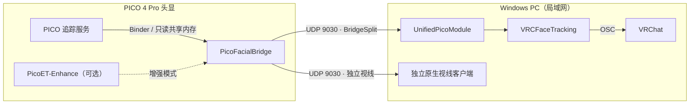

<div align="center">

# PicoFacialBridge

免 Root 的 PICO 4 Pro 局域网眼动与面部追踪桥接应用，无需 Magisk 或 PICO Connect，可与 Virtual Desktop 同时运行。

[](https://github.com/WolalaQAQ/PicoFacialBridge/actions/workflows/android.yml)
[](https://github.com/WolalaQAQ/PicoFacialBridge/releases)
[](LICENSE)

[English](README.md) | **简体中文**

[快速上手](#快速上手) · [增强模式](#可选增强模式) · [界面说明](#界面说明) · [独立原生视线](#独立原生视线) · [故障排查](#故障排查) · [开发说明](#开发说明) · [社区](#社区)

</div>

---

## 为什么使用 PicoFacialBridge

PicoFacialBridge 是运行在 PICO 4 Pro 上的独立 Android 应用，负责读取头显的眼动与面部追踪数据，并通过局域网转发给 Windows PC。

- **完全免 Root：** 不需要 Root、Magisk、Shizuku 或 PICO Connect。ADB 仅在安装或调试时可选使用，日常使用不需要连接电脑。
- **与串流软件共存：** 不占用 OpenXR 会话，可与 Virtual Desktop 同时运行；启动后通过前台服务与常驻通知在后台持续转发，可直接关闭应用窗口。
- **按源频率拆分发送：** 眼动与面部通道各自按原始采样节奏独立发送，不做平滑或插值，且只传输 PC 端实际订阅的通道。
- **支持双路消费者：** 可同时向 VRCFaceTracking（经由 [UnifiedPicoModule](https://github.com/WolalaQAQ/UnifiedPicoModule)）和独立的原生视线客户端提供数据。



> [!IMPORTANT]
> Avatar 眼面捕使用 **BridgeSplit** 协议，PC 端需要安装 [UnifiedPicoModule](https://github.com/WolalaQAQ/UnifiedPicoModule)。旧版 `PicoFacialDataModule` 及其分支无法接收该格式；如果仍需旧协议，请使用 [v0.2.0](https://github.com/WolalaQAQ/PicoFacialBridge/releases/tag/v0.2.0)。

---

## 兼容性与环境要求

已在 **PICO 4 Pro**、**PICO OS 5.13.7**（Android 10 / API 29，`arm64-v8a`）免 Root 环境下验证。

| 项目 | 要求 |
|---|---|
| **头显** | 具备正常眼动与面部追踪硬件的 PICO 4 Pro |
| **固件版本** | PICO OS 5.13.7（依赖 PICO 内部追踪服务与共享内存布局） |
| **PC（Avatar 眼面捕）** | Windows 系统、VRCFaceTracking 与 [UnifiedPicoModule](https://github.com/WolalaQAQ/UnifiedPicoModule) |
| **PC（独立原生视线）** | 实现[独立视线订阅协议](GAZE-PROTOCOL_zh.md)的客户端 |
| **网络** | 头显与 PC 处于同一可信局域网，**UDP 9030** 端口可达 |
| **VRChat** | 已配置面部追踪的 Avatar，并开启 OSC |

---

## 快速上手

### 1. 在头显上安装 APK

1. 从 [Releases](https://github.com/WolalaQAQ/PicoFacialBridge/releases) 下载 `PicoFacialBridge-v<版本>-arm64-v8a-debug.apk`（例如 `PicoFacialBridge-v0.7.0-arm64-v8a-debug.apk`）。Release 页面附带的源码 ZIP 不是安装包。
2. 使用头显内的文件管理器或常用侧载工具安装。如果习惯使用 ADB，开启开发者模式与 USB 调试后连接头显并执行：

   ```sh
   adb install -r PicoFacialBridge-v0.7.0-arm64-v8a-debug.apk
   ```

3. 在头显的 2D 应用列表中打开 **PicoFacialBridge**。确认系统设置里已开启眼动与面部追踪，点击**启动**，并授予应用请求的两项追踪权限。

> [!NOTE]
> 发布的 APK 使用自动生成的 debug 签名，不同构建之间的签名可能不同。如果 Android 因签名不一致拒绝覆盖安装，请确认下载来源后先卸载旧版，再安装新版。卸载会重置应用内的偏好设置。

### 2. 在 PC 上安装 UnifiedPicoModule

1. 按照 [UnifiedPicoModule 说明文档](https://github.com/WolalaQAQ/UnifiedPicoModule/blob/main/README_zh.md) 在 VRCFaceTracking 中安装模块。安装前请停用其他 PICO 模块，避免 UDP 9030 端口冲突。
2. 模块默认通过局域网多播（`239.255.255.250`）自动发现头显。如果自动发现失败，或同一局域网内有多台头显，请在 `UnifiedPicoModule.json` 中填写头显的 IPv4 地址（可在应用**诊断**页查看），保存后重启 VRCFT：

   ```json
   "Bridge": { "IP": "192.168.1.123" }
   ```

   配置文件位置与其余参数请参阅 [UnifiedPicoModule 配置说明](https://github.com/WolalaQAQ/UnifiedPicoModule/blob/main/docs/configuration_zh.md)。

### 3. 日常使用流程

1. 佩戴头显，打开 **PicoFacialBridge** 并点击**启动**。状态变为**运行中**后即可关闭应用窗口。
2. 在 PC 上启动 **VRCFaceTracking**。连接成功后，PicoFacialBridge 会显示客户端地址与非零发送频率，VRCFT 的 Output 页面会显示 `Bridge/BridgeSplit: state=Connected`。
3. 启动 Virtual Desktop 与 VRChat，并确认 OSC 已开启。
4. 结束使用时，在应用内或下拉系统常驻通知点击**停止**。

---

## 可选增强模式

如果头显安装了可选的 [PicoET-Enhance](https://github.com/WolalaQAQ/PicoET-Enhance) Magisk 模块，PicoFacialBridge 会自动识别为**增强模式**，并向 PC 转发真实瞳孔直径以及逐眼独立表情（包括经由 `X` 包传输的独立右眉心上抬）。

PicoFacialBridge 本身始终保持免 Root；模块安装与头显端后处理参数配置均在 [PicoET-Enhance](https://github.com/WolalaQAQ/PicoET-Enhance) 中管理。

---

## 界面说明

应用顶部常驻服务状态栏（运行状态、当前追踪模式、**启动 / 停止 / 重启** 按钮，以及 **中文 / English** 切换按钮），下方分为三个页面。切换语言不会重置当前页面或传输开关设置。

### 眼面捕

用于管理发往 `UnifiedPicoModule` 的 Avatar 眼面捕数据：

- **传输眼追 / 传输面捕：** 两个通道可独立开关，修改即时生效并自动保存。两项同时关闭时暂停采集与转发，但保留发现与控制通信。
- **发送频率（Hz）：** 统计最近 1 秒内成功发给 Avatar 客户端的新源帧数，重复旧帧与心跳不计入。显示 `0 Hz` 表示未连接客户端、通道已关闭或暂无新鲜采样。
- **通道交集规则：** 实际发送的通道是本地开关与 PC 订阅的交集。仅开启眼追时，除原生眼动数据外还会附带眨眼、眉毛、`EyeWide`、`EyeSquint` 等眼周表情，此时面捕频率显示为 `0`；仅开启面捕时，不发送原生眼动数据和眼周表情。
- **权限说明：** PICO 的眼动与面部追踪共用同一套系统算法，因此即便只传输单个通道，也需要同时授予两项权限。本地开关只控制数据是否发送，不控制摄像头电源。

### Gaze 视线

用于查看独立原生视线客户端的连接与数据状态：

- 显示订阅状态（`等待客户端订阅`、`已订阅`、`客户端已退订`、`订阅已过期` 或 `发送失败`）、客户端地址、订阅 ID、会话 epoch、租约剩余时间、发送频率与已发送包数。
- 单独列出**原生样本**状态（`等待新样本`、`新鲜 · 融合视线有效`、`样本新鲜 · 视线无效` 或 `样本已过期`）与最新源样本年龄。
- 点击**前往眼追传输设置**可跳回眼面捕页的共用眼追开关；关闭该开关会同时停止 Avatar 眼部和独立视线两路输出。

### 诊断

集中展示头显 UDP 地址（`<IPv4>:9030`）、原生眼部 / 面部帧计数、环形缓冲区历史溢出、最近错误，以及可展开和复制的服务日志。

点击诊断页顶部的**追踪数值 →** 可进入只读的实时**追踪监视**子页：

- **四个分区标签：** `眼眉`（默认）、`面颊`、`嘴部` 与 `眼动`。前三个表情页将 52 + 1 项表情（含增强模式下的独立 `BrowInnerUpR`）按 32 行左右成对排列；`眼动`页显示瞳孔线上原值及毫米值（`原值 ÷ 10`）、0–1 睁眼度、带正负的 −1…1 头部相对 XYZ 视线向量、状态字及原生源时间戳。
- **逐帧真实读数：** 页面可见时随屏幕刷新率直接读取最新源值，退出即停止回调，不会触发额外采集或改动 PC 订阅。数值不随 0–1 强度条限幅（超范围以琥珀色标出）；无效、过期、模式过滤、未采集和关闭均有明确状态标识，不会用默认值或零值替代。
- **顶部工具栏与监视工具（`⋯`）：** 支持按中英文名称搜索字段、筛选有效非零项（`|v| > 0.01`）、点击**冻结 / 继续**暂停界面刷新而不中断后台转发；打开**发送包详情**可分别查看源快照以及 Avatar 和独立视线两路最近一次成功发送的 `E` / `A` / `F` / `X` 原包（含有效位、通道掩码、epoch 与分组时钟）。

---

## 独立原生视线

兼容的 PC 视线客户端可以从自身的临时 UDP 端口直接向头显的 **UDP 9030** 订阅原生视线，无需运行 VRCFaceTracking 或 PC 端中继。

- **独立生命周期：** Avatar 眼面捕客户端与独立视线客户端各自连接、续租和停止，互不干扰，停止其一不会退订另一方。
- **低延迟原生 `E` 包：** 仅订阅视线时，只发送最新一帧新鲜（150 ms 以内）的原生 `E` 样本，不等待面部表情，也不发送 `A` / `F` / `X` 包。
- **共用本地眼追开关：** 需保持 PicoFacialBridge 中的**传输眼追**处于开启状态；关闭后会同时停止两路眼动输出。

控制命令、租约续期、epoch 规则及报文偏移请参阅 [GAZE-PROTOCOL_zh.md](GAZE-PROTOCOL_zh.md)。

---

## 故障排查

| 现象 | 检查与处理 |
|---|---|
| **VRCFT 找不到头显** | 确认 PC 与头显在同一局域网，路由器未开启访客网络或客户端隔离，并排查 PC 上的 VPN 或虚拟网卡。可在 `UnifiedPicoModule.json` 中手动指定 `Bridge.IP`。 |
| **被防火墙拦截** | 在 Windows 防火墙中放行 VRCFaceTracking 在专用网络使用 **UDP 9030**，无需整体关闭防火墙。 |
| **已连接但发送频率始终为 0 Hz** | 确认应用内传输开关已开启，佩戴并唤醒头显，同时检查两项追踪权限与 PICO 系统追踪设置。 |
| **提示错误或不支持的布局** | 打开**诊断 → 服务日志**复制报错信息，并核对头显型号与 PICO OS 版本。 |
| **休眠或切换 Wi-Fi 后中断** | 唤醒头显，在**诊断**页核对当前 IPv4 地址，点击**重启**后重新连接 VRCFT。 |
| **VRCFT 有数据但 Avatar 无反应** | 检查 VRCFT 的 Output 页面、确认 VRChat 已启用 OSC，并核对 Avatar 的面部追踪参数配置。 |
| **覆盖安装 APK 失败** | 不同构建的 debug 签名可能不一致，请先卸载旧版再安装新版。确认下载的是用户 APK，而不是 `androidTest` 测试 APK。 |

[提交 Issue](https://github.com/WolalaQAQ/PicoFacialBridge/issues) 时，请附上应用版本、头显型号、PICO OS 版本、VRCFT 与模块版本、复现步骤，以及脱敏后的诊断日志。请勿上传原始面部追踪样本、设备标识或签名密钥。

---

## 隐私与安全

PicoFacialBridge 只在局域网内向已连接客户端转发追踪数据，监视器查看的实时数值仅驻留内存（不写盘、不写日志），服务日志仅记录连接状态、频率与有效性。应用仅使用标准 Android 运行时权限，不屏蔽系统摄像头与传感器指示，也不修改系统分区或打包 PICO 私有库。

> [!WARNING]
> BridgeSplit 与独立视线协议的 UDP 报文均不含加密与身份认证。请仅在可信局域网内使用，切勿将 UDP 9030 端口暴露到公网。

---

## 开发说明

### 项目结构与协议

| 目录 | 说明 |
|---|---|
| `bridge/` | 免 Root Android 应用、三页仪表盘、追踪监视器与 UDP 前台服务 |
| `shared/` | JNI 原生层、共享内存解析、帧分发与 BridgeSplit 线格式封装 |
| `probe/` | 开发者诊断应用 |
| `tests/` | 主机端单元 / 协议 / 帧率 / 视线测试、界面契约检查与 APK 分发校验 |

BridgeSplit 通过 **UDP 9030** 通信，并使用多播地址 **239.255.255.250** 完成自动发现。完整包格式与控制流程见 [UnifiedPicoModule 协议参考](https://github.com/WolalaQAQ/UnifiedPicoModule/blob/main/docs/protocol_zh.md)，独立视线命令空间见 [GAZE-PROTOCOL_zh.md](GAZE-PROTOCOL_zh.md)。修改协议时需与 `UnifiedPicoModule` 同步更新。

### 从源码构建

需要 **JDK 17** 与 Android SDK 命令行工具（Gradle Wrapper `8.9`，Android Gradle Plugin `8.7.3`）。配置好 `JAVA_HOME`、`ANDROID_HOME` 并将 `sdkmanager` 加入 `PATH` 后，安装固定版本的构建依赖：

```sh
sdkmanager --licenses
sdkmanager "platforms;android-35" "build-tools;35.0.0" "ndk;26.1.10909125" "cmake;3.22.1"

git clone https://github.com/WolalaQAQ/PicoFacialBridge.git
cd PicoFacialBridge

# Linux / macOS
bash ./gradlew :bridge:assembleDebug

# Windows PowerShell
.\gradlew.bat :bridge:assembleDebug
```

用户应用只需构建 `:bridge`（`:probe` 为开发者诊断应用）。构建完成后，带本地 debug 签名的可安装 APK 位于 `bridge/build/outputs/apk/debug/bridge-debug.apk`。

### 主机测试与检查

```sh
bash tests/run-host-tests.sh
python3 tests/test_ui_dashboard.py
python3 tests/test_inspector_frames.py
python3 tests/test_rootless_boundary.py
pwsh -File tests/check-translations.ps1

# 需先构建 debug APK（仅依赖 Python 3 标准库）
python3 tests/test_apk_distribution.py
```

在 Windows 上也可以单独运行 `tests/` 下的 PowerShell 测试脚本（`run-unit.ps1`、`run-protocol.ps1`、`run-cadence.ps1`、`run-forwarding.ps1`、`run-independent.ps1`、`run-expressions.ps1`、`run-gaze.ps1`）。这些脚本从不纳入版本控制的本地文件 `tools/jdk-path.txt` 读取 JDK 路径，可用 `Set-Content tools/jdk-path.txt $env:JAVA_HOME` 生成。

版本历史与 GitHub Releases 自动发布流程请参阅 [CHANGELOG_zh.md](CHANGELOG_zh.md) 与 [docs/RELEASING_zh.md](docs/RELEASING_zh.md)。

### 参与贡献

欢迎提交 Issue 与 Pull Request。改动应保持协议兼容与各通道的原生发送节奏，涉及用户可见变更时请同步更新中英文 README 和界面字符串资源。切勿提交签名密钥、本机 SDK 路径、原始生物特征样本或个人测试记录。

---

## Pico-Enhance 生态

| 项目 | 作用 |
|---|---|
| **[PicoFacialBridge](https://github.com/WolalaQAQ/PicoFacialBridge)** | 免 Root 的 PICO 4 Pro 眼动与面部追踪桥接应用（本仓库） |
| **[UnifiedPicoModule](https://github.com/WolalaQAQ/UnifiedPicoModule)** | 接收 BridgeSplit 数据流的 Windows VRCFaceTracking 模块 |
| **[PicoET-Enhance](https://github.com/WolalaQAQ/PicoET-Enhance)** | 可选 Magisk 模块，解锁逐眼独立表情与真实瞳孔直径 |
| **[VRCFT-Enhance](https://github.com/WolalaQAQ/VRCFT-Enhance)** | 降低 VRCFaceTracking OSC 输出延迟的补丁工具 |
| **[VD-PicoEnhance](https://github.com/WolalaQAQ/VD-PicoEnhance)** | Virtual Desktop PICO 增强插件（码率 / 分辨率解锁与体验优化） |
| **[PicoRegionSwitch](https://github.com/WolalaQAQ/PicoRegionSwitch)** | 在国行与国际版之间切换 PICO 系统应用 |
| **[PicoUSB-Quiet](https://github.com/WolalaQAQ/PicoUSB-Quiet)** | 屏蔽 PICO 上重复弹出的 Android USB 权限提示 |

---

## 社区

使用求助、交流与版本更新通知，欢迎加入 Pico-Enhance 社区。

<a href="https://discord.gg/ueSEydeVD8"></a>

**QQ 群：** 1129699813，用 QQ 扫描下方二维码即可加入。


---

## 致谢

感谢 [thoricelli](https://github.com/thoricelli) 开发的原版 [PicoFacialDataDaemon](https://github.com/thoricelli/PicoFacialDataDaemon) 与 [PicoFacialDataModule](https://github.com/thoricelli/PicoFacialDataModule)。

PicoFacialBridge 在开发时参考了原项目的 Binder 调用、共享内存布局与 UDP 发现思路，并在此基础上将头显端重构为免 Root Android 应用，提供独立的生命周期管理与 BridgeSplit 线格式。

本项目是独立的社区项目，不是 PICO 官方产品，也不代表上游作者的官方发布。

## 许可证

与上游项目一致，本项目采用 [MIT 许可证](LICENSE)。完整许可与保留的上游版权声明见 [LICENSE](LICENSE) 与 [THIRD_PARTY_NOTICES.md](THIRD_PARTY_NOTICES.md)，两份文件会同时打包进每个 APK 与 GitHub Release 附件中。
